  
  
  
  
  
  

<strong>An end-to-end, educational heart-disease classification project — from tabular data exploration to a live prediction interface.</strong>

  <a href="#overview">Overview</a> ·
  <a href="#problem-statement">Problem</a> ·
  <a href="#solution-and-objectives">Solution</a> ·
  <a href="#architecture">Architecture</a> ·
  <a href="#dataset">Dataset</a> ·
  <a href="#machine-learning-method">ML Method</a> ·
  <a href="#evaluation">Evaluation</a> ·
  <a href="#api-reference">API</a> ·
  <a href="#run-locally">Run locally</a>

---

## Overview

**HeartGuard** is a machine-learning learning project that explores a binary heart-disease dataset and exposes a Random Forest classifier through a web application.

The repository brings together three parts:

1. **Data science experiments** — exploratory data analysis, train/test splitting, model comparison and notebook-based evaluation.
2. **Prediction service** — a Python FastAPI backend that validates 13 input fields and returns a model class and probability scores.
3. **Interactive web application** — a responsive HTML, CSS and JavaScript interface hosted with the API on Vercel.

The live application is available at **[heartguard-health.vercel.app](https://heartguard-health.vercel.app/)**.

> **Medical and safety notice:** HeartGuard is an educational software demonstration, not a medical device. It does not diagnose heart disease, estimate an individual's clinically validated risk, recommend treatment or replace a qualified healthcare professional. The model's output scores are not calibrated clinical probabilities. Never use this application to make health decisions or delay medical care.

## Live application

### [Launch HeartGuard ↗](https://heartguard-health.vercel.app/)

[Application](https://heartguard-health.vercel.app/) · [API health](https://heartguard-health.vercel.app/api/health) · [Model metadata](https://heartguard-health.vercel.app/api/model) · [Source code](https://github.com/Adarsh-Singh-Chauhan/Disease-Prediction-ML)

The deployed routes were checked during this README update:

| Check | Observed response |
|---|---|
| Web application | HTTP 200 |
| `GET /api/health` | HTTP 200 · `status: ok` |
| Dataset availability | Available · 303 rows |
| Input feature count | 13 |
| `GET /api/model` | HTTP 200 · Random Forest metadata |

The health endpoint confirms that the dataset file and required columns are available. It does not by itself prove model accuracy or clinical suitability.

## Problem statement

Heart-disease datasets contain multiple numerical measurements and encoded categorical attributes. For a learner, it can be difficult to move from a raw CSV file to a repeatable modelling workflow and then understand how a trained classifier is exposed to an application.

This project addresses that engineering and learning problem:

- How can a small tabular dataset be explored and prepared for classification?
- How can multiple classical machine-learning approaches be compared using a consistent train/test split?
- How can a selected estimator be exposed behind a validated API?
- How can a user inspect the model's output without presenting it as a medical diagnosis?

## Solution and objectives

HeartGuard turns the repository's dataset and model experiments into a single, demonstrable workflow.

**Project objectives**

- Explore the dataset's structure, distributions and feature relationships.
- Prepare a reproducible, stratified train/test split for notebook experiments.
- Compare classification models with standard evaluation metrics.
- Serve a Random Forest model through a typed FastAPI endpoint.
- Provide a responsive form for entering the dataset's 13 predictor values.
- Return the predicted dataset class and model scores with an explicit safety notice.
- Document the architecture, setup, evaluation context and limitations.

**What the project does not attempt to do**

- It does not provide a clinical diagnosis or medical advice.
- It does not establish causal relationships between input fields and disease.
- It does not claim the notebook's hold-out accuracy as live or clinical performance.
- It does not provide patient accounts, a medical-record system or a persistent patient database.

## Key features

| Area | Implemented capability |
|---|---|
| Prediction workspace | Single-page interface with an interactive 13-field form |
| Input validation | Numeric ranges and categorical codes validated by Pydantic |
| Model inference | Random Forest classifier with a fixed configuration |
| Model lifecycle | Model is fitted lazily and cached once per serverless worker |
| Result view | Predicted target class, predicted-class score and positive-class score |
| Service monitoring | Health endpoint reports dataset and feature availability |
| Model metadata | Endpoint returns estimator settings and feature names |
| Data science | EDA, stratified splitting, model comparison and evaluation notebooks |
| Responsive UI | HTML/CSS interface with responsive styling and animated visual elements |
| Deployment | FastAPI Python function and static assets packaged for Vercel |

## Architecture

The following diagram describes the implementation currently present in this repository.

  

### Request lifecycle

1. A user enters the 13 dataset attributes in the browser form.
2. JavaScript converts the form values to numbers and sends a JSON request to `POST /api/predict`.
3. FastAPI validates the request against the `PredictionInput` Pydantic model. Extra fields and values outside the configured ranges are rejected.
4. The API obtains the cached model. On the first model request handled by a worker, it reads `heart.csv`, checks required columns, removes rows with missing required values and fits the configured Random Forest.
5. The model returns class probabilities. The API selects the class with the largest probability and prepares the response.
6. The browser displays the predicted dataset class, model scores, training-row count and safety notice.

### Deployment architecture

- **Frontend:** static HTML, CSS, JavaScript and favicon files from `public/`.
- **Backend:** `app.py`, executed as a Python serverless function.
- **Dataset:** `heart.csv`, included in the function bundle through `vercel.json`.
- **Model:** scikit-learn Random Forest, initialized and cached in each running worker.
- **Hosting:** Vercel, with the repository's Git-connected deployment.

There is no separate database in the current implementation. The API does not create a persistent patient-record store.

## Technology stack and tools

| Layer | Technology | Purpose in this project |
|---|---|---|
| Language | Python 3.12 | Backend, data handling and ML experiments |
| Data processing | Pandas, NumPy | CSV loading, tabular transformations and numerical operations |
| Machine learning | scikit-learn | Random Forest, preprocessing, train/test split and evaluation |
| API framework | FastAPI | Health, model metadata and prediction endpoints |
| Schema validation | Pydantic | Typed request fields, allowed categories and numeric bounds |
| Frontend | HTML5 | Application structure and form controls |
| Styling | CSS3 | Responsive layout, visual system and animations |
| Browser logic | Vanilla JavaScript | API requests, form conversion and result rendering |
| EDA / visualisation | Matplotlib, Seaborn | Notebook plots and exploratory analysis |
| Experiment environment | Jupyter Notebook / Google Colab | Data exploration and model experiments |
| Deployment | Vercel | Python serverless hosting and static assets |
| Version control | Git / GitHub | Source control and collaboration |

### Runtime dependencies

The pinned application dependencies are maintained in [requirements.txt](./requirements.txt):

- FastAPI 0.115.12
- Uvicorn 0.34.2
- Pandas 2.2.3
- NumPy 2.2.6
- scikit-learn 1.6.1

Notebook-only experiments also reference Matplotlib, Seaborn, Jupyter/Colab and XGBoost. Those experiment tools are not all required to run the deployed FastAPI application.

## Dataset

The checked-in [heart.csv](./heart.csv) file was inspected for this documentation update.

| Dataset property | Current value |
|---|---:|
| Rows | 303 |
| Predictor features | 13 |
| Target columns | 1 |
| Total columns | 14 |
| Target class 0 | 138 rows |
| Target class 1 | 165 rows |
| Missing values in checked-in CSV | 0 |

The dataset uses numeric encodings for several categorical attributes. The application intentionally presents these as dataset codes; it does not translate them into clinical interpretations.

### Feature dictionary

| Field | Meaning / unit shown in the application | Validation in API |
|---|---|---|
| `age` | Age in years | 18–100 |
| `sex` | Encoded category | 0 or 1 |
| `cp` | Chest-pain category code | 0–3 |
| `trestbps` | Resting blood pressure · mm Hg | 70–250 |
| `chol` | Serum cholesterol · mg/dL | 100–700 |
| `fbs` | Fasting blood-sugar code | 0 or 1 |
| `restecg` | Resting ECG category code | 0–2 |
| `thalach` | Maximum heart rate · bpm | 50–250 |
| `exang` | Exercise-induced angina code | 0 or 1 |
| `oldpeak` | ST-depression field | 0–10 |
| `slope` | ST-slope category code | 0–2 |
| `ca` | Major-vessel count code | 0–4 |
| `thal` | Thal category code | 0–3 |
| `target` | Binary label in the source dataset | 0 or 1 |

The API predicts the dataset's binary `target` label. The source code does not establish that this label or the returned model score is a clinically validated diagnosis or risk estimate.

## Machine-learning method

### Notebook workflow

The analysis notebooks document the following workflow:

1. **Load:** read `heart.csv` into a Pandas DataFrame.
2. **Explore:** inspect feature types, distributions and relationships using Pandas, Matplotlib and Seaborn.
3. **Separate:** use the 13 predictor columns as `X` and the binary `target` column as `y`.
4. **Split:** create an 80/20 stratified train/test split using `random_state=42` in the evaluation notebook.
5. **Preprocess:** scale numerical inputs for scale-sensitive model experiments; the later modelling notebook also uses preprocessing pipelines and imputers.
6. **Compare:** train classifiers and review accuracy, precision, recall, F1, ROC-AUC and confusion matrices where implemented.
7. **Serve:** expose a separately configured Random Forest model through the FastAPI prediction route.

### Classifiers explored

The notebooks include experiments with:

- Logistic Regression
- Gaussian Naive Bayes
- Support Vector Machine (RBF)
- K-Nearest Neighbors
- Decision Tree
- Random Forest
- XGBoost
- Multi-layer Perceptron (Neural Network)

The presence of an algorithm in a notebook means it was explored there; it does not mean every algorithm is used by the live API.

### Model used by the live API

The production prediction route uses this configuration from `app.py`:

<pre><code>RandomForestClassifier(
    n_estimators=200,
    max_depth=6,
    random_state=42,
    n_jobs=1,
)</code></pre>

**Important implementation detail:** the API does not load a pre-trained model artifact. The first prediction or model-metadata request handled by a serverless worker calls `get_model()`, reads the bundled CSV, fits the estimator on all usable rows and caches it with `lru_cache(maxsize=1)` for that worker.

The live API therefore has a different lifecycle from the notebook's held-out evaluation: it fits on the available dataset rather than evaluating an individual request against a held-out test set.

## Evaluation

The following metrics are recorded in [Model_Evoluation_py.ipynb](./Model_Evoluation_py.ipynb), using its documented stratified 80/20 split (242 training rows and 61 test rows).

| Model | Accuracy | Precision | Recall |
|---|---:|---:|---:|
| Logistic Regression | 80.33% | 76.92% | 90.91% |
| Gaussian Naive Bayes | 81.97% | 78.95% | 90.91% |
| SVM (RBF) | 81.97% | 77.50% | 93.94% |
| K-Nearest Neighbors | 80.33% | 76.92% | 90.91% |
| Decision Tree | 78.69% | 75.00% | 90.91% |
| **Random Forest** | **83.61%** | **78.05%** | **96.97%** |

The same notebook records a 5-fold cross-validation accuracy of approximately **83.14%** for its Random Forest experiment.

**How to interpret these numbers**

- These are historical notebook outputs for one small dataset and one experiment setup.
- They are not a guarantee of future predictions or a clinical performance benchmark.
- The separate `heart_modeling.ipynb` notebook experiments with preprocessing pipelines and a different Random Forest configuration (300 estimators with class weighting); its outputs should not be mixed with the table above.
- The live API has its own 200-estimator configuration and fits on the full usable CSV. It does not report the notebook's hold-out metrics as per-request accuracy.
- A serious research evaluation should use independent validation data, repeated or nested cross-validation where appropriate, calibration analysis, subgroup checks, leakage review and documented dataset provenance.

## API reference

The application exposes three JSON endpoints.

| Method | Endpoint | Purpose |
|---|---|---|
| `GET` | `/api/health` | Check service and dataset availability |
| `GET` | `/api/model` | Return estimator configuration, training-row count and feature names |
| `POST` | `/api/predict` | Validate the input profile and return the model prediction |

### Example prediction request

<pre><code>{
  "age": 52,
  "sex": 1,
  "cp": 2,
  "trestbps": 130,
  "chol": 204,
  "fbs": 0,
  "restecg": 1,
  "thalach": 160,
  "exang": 0,
  "oldpeak": 1.0,
  "slope": 1,
  "ca": 0,
  "thal": 2
}</code></pre>

### Prediction response fields

| Field | Description |
|---|---|
| `prediction` | Predicted binary class from the dataset |
| `label` | Human-readable positive/negative dataset-class label |
| `model_score` | Model probability score for the predicted class, expressed as a percentage |
| `positive_class_score` | Model probability score for class 1, expressed as a percentage |
| `training_rows` | Number of usable CSV rows used to fit the model |
| `model` | Estimator name and configuration summary |
| `notice` | Responsible-use disclaimer returned with the result |

These probability scores reflect the fitted estimator's output. They are not calibrated clinical probabilities.

## Repository structure

<pre><code>Disease-Prediction-ML/
├── app.py
├── heart.csv
├── requirements.txt
├── vercel.json
├── .python-version
├── LICENSE
├── README.md
├── public/
│   ├── index.html
│   ├── styles.css
│   ├── app.js
│   └── favicon.svg
├── assets/
│   ├── heartguard-hero.svg
│   └── heartguard-architecture.svg
├── heart_eda_train_split.ipynb
├── heart_modeling.ipynb
├── Model_Evoluation_py.ipynb
├── artifacts.zip
└── heartguard-health-main (2).zip</code></pre>

The two ZIP archives are existing repository files; the notebooks and application source are the primary materials for understanding and reproducing the workflow.

## Run locally

### 1. Clone the repository

<pre><code>git clone https://github.com/Adarsh-Singh-Chauhan/Disease-Prediction-ML.git
cd Disease-Prediction-ML</code></pre>

### 2. Create and activate a Python 3.12 environment

**Windows PowerShell**

<pre><code>py -3.12 -m venv .venv
.venv\Scripts\Activate.ps1</code></pre>

**macOS / Linux**

<pre><code>python3.12 -m venv .venv
source .venv/bin/activate</code></pre>

### 3. Install the application dependencies

<pre><code>python -m pip install --upgrade pip
pip install -r requirements.txt</code></pre>

### 4. Start the API and web application

<pre><code>uvicorn app:app --reload</code></pre>

Open **[http://127.0.0.1:8000](http://127.0.0.1:8000)**.

Useful local checks:

- [http://127.0.0.1:8000/api/health](http://127.0.0.1:8000/api/health)
- [http://127.0.0.1:8000/api/model](http://127.0.0.1:8000/api/model)

### Run the notebooks

For notebook-based exploration, install the additional analysis tools:

<pre><code>pip install matplotlib seaborn jupyter xgboost
jupyter notebook</code></pre>

Open the notebook you want to reproduce and execute its cells in order. Keep `heart.csv` or the required experiment ZIP in the notebook's working directory, as requested by that notebook.

## Deployment

The repository contains a Vercel configuration in [vercel.json](./vercel.json).

- The Python function entry point is `app.py`.
- The function's maximum duration is configured to 60 seconds.
- `heart.csv` and the `public/**` assets are included in the function bundle.
- The checked live deployment is [heartguard-health.vercel.app](https://heartguard-health.vercel.app/).

For a new deployment, connect this GitHub repository to a Vercel project and use the repository's `main` branch as the production branch. Confirm the configured Python runtime and verify the health endpoint after deployment.

## Team

The original project README records the following team responsibilities:

| Member | Recorded contribution |
|---|---|
| Ansh | ML Lead |
| Sanjeet | EDA Analysis |
| Anushka | Database and Connectivity |
| Prakash | Assistant |
| OM Tiwari | Backend |
| Adarsh | Model Evaluation |

## Limitations and responsible use

- The dataset is small and its provenance and population representativeness are not fully documented in this repository.
- Several categorical variables are numeric codes. The interface does not provide clinical definitions for those codes.
- The live model is trained on the bundled dataset at runtime; no independently validated or versioned model artifact is loaded.
- Model probability scores may be poorly calibrated and can be wrong.
- The application is not validated for clinical use, diagnosis, screening, triage or treatment decisions.
- The current implementation does not provide authentication, user accounts or a patient-record database.
- Do not submit identifiable patient information to a public demo.
- For symptoms or health concerns, seek advice from a qualified healthcare professional.

## Roadmap

Potential next steps for a research-grade iteration:

- Add automated tests for request validation, service health and prediction responses.
- Track dataset provenance, licensing and version changes.
- Package and version trained model artifacts with reproducible training metadata.
- Add repeatable cross-validation and independent external validation.
- Evaluate calibration, subgroup performance, class imbalance and data leakage.
- Add model explainability for educational use, with appropriate limitations.
- Add accessibility checks and automated deployment smoke tests.

These are proposed improvements, not features claimed to be present today.

## Contributing

Suggestions and improvements are welcome.

1. Open an issue describing the problem, experiment or proposed change.
2. Keep changes focused and include reproducible steps or evidence.
3. Add or update tests when changing API or model behaviour.
4. Do not add private data, identifiable health information or unsupported clinical claims.
5. Submit a pull request with a concise summary of the change.

## License

This project is released under the [MIT License](./LICENSE). See the license file for the complete terms.

---

**Built as a collaborative machine-learning learning project.**

[GitHub repository](https://github.com/Adarsh-Singh-Chauhan/Disease-Prediction-ML) · [Live HeartGuard demo](https://heartguard-health.vercel.app/) · [Adarsh Singh Chauhan](https://github.com/Adarsh-Singh-Chauhan)

Explore responsibly · Validate rigorously · Never use this project as a medical diagnosis.

